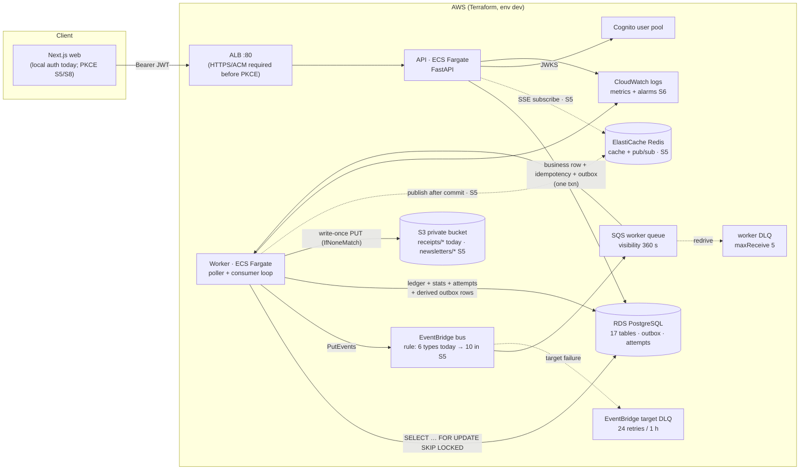
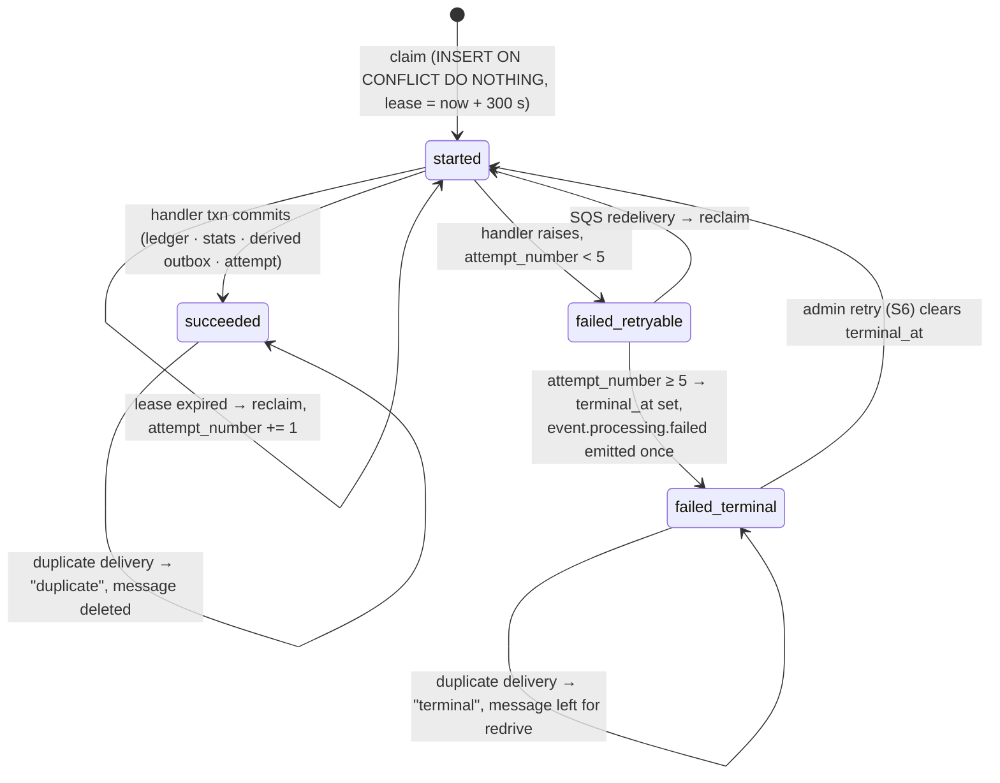
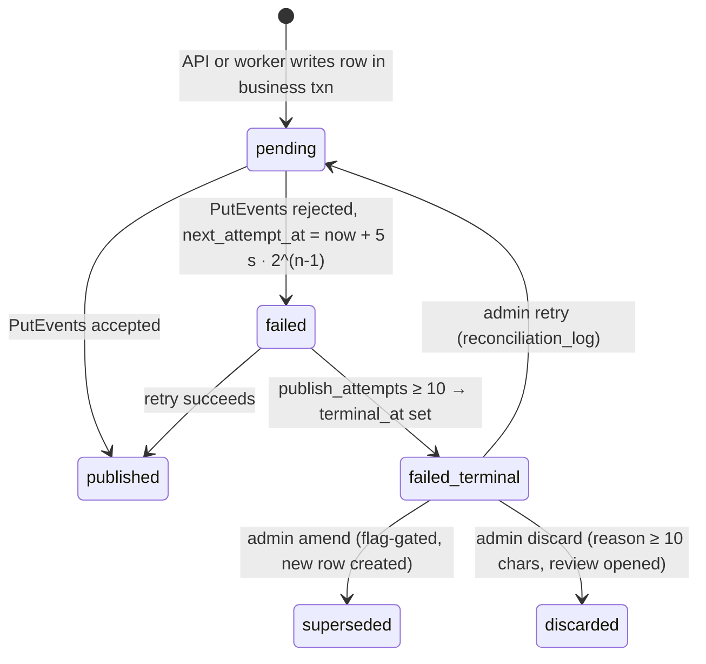
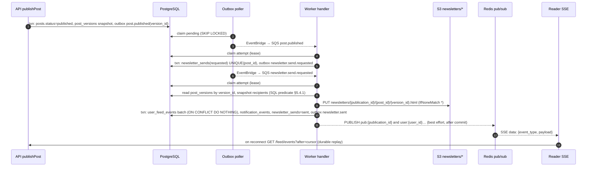

# PulsePress Architecture Revision — v1.2 (post-Sprint 4)

**Status:** proposed revision to `docs/architecture.md` v1.1, to be folded in before Sprint 5 starts.
**Basis:** as-built code at `main` commit `3e76bff` (Sprints 0–4 merged) compared against the
spec pack (`SPEC.md` v1.2, `architecture.md` v1.1, `event-catalog.md` v1.1, `sprint-plan.md` v1.1).
**Method:** every finding below was verified against the code, the tracked migration, Terraform,
the GitHub Actions history, or a local run of the test suites. Items marked *assumption* were not
verifiable from the repository.

---

## 1. Decision

- **Keep the two write-shape architecture unchanged.** It is implemented faithfully: commerce
  writes are idempotent and atomic with the outbox; publishing is plain CRUD; `publishPost` is the
  only event door; the API writes no ledger rows. Nothing in this revision weakens that.
- **Promote the Sprint-4 worker processing model to canonical.** The as-built worker (durable
  claim lease, receipt-before-commit, attempt-count terminal accounting, write-once receipts) is
  stronger than the v1.1 text and must be documented as the contract (proposed ADR-0013).
- **Fix repository integrity before any Sprint-5 code.** The Sprint-4 migration and the spec pack
  are gitignored. CI on `main` is red because of it, and a fresh clone cannot deploy a schema the
  worker can use. This is the one blocking item.
- **Introduce a shared schema package before Sprint 5.** The worker carries a hand-copied subset
  of the SQLAlchemy models. Sprint 5 needs six more tables in the worker; copying them doubles the
  drift surface that already broke CI.
- **Route every catalog event type from Sprint 5 on.** The Sprint-4 routing allowlist (poller
  constant + EventBridge rule) leaves `post.published` rows `pending` forever, which will make the
  Sprint-6 outbox alarms fire permanently.
- **Make TLS a Sprint-5 prerequisite.** Cognito ID tokens currently traverse an HTTP-only ALB.

## 2. Assumptions and requirements that affect this revision

- Phase 1 scope and the 10-event catalog are unchanged. No new event names or payload fields are
  proposed; two *additive* columns on read-model tables are proposed for idempotent fanout.
- Phase-1 scale target (*assumption*): ≤ 1k users, ≤ 100 publications, ≤ 10k subscribers on the
  largest publication, ≤ 100 req/s peak under k6. The design must scale horizontally beyond that
  without redesign, but capacity numbers below use these figures.
- Single region, single AZ for compute; RDS single-AZ (demo cost profile, ADR-0007).
- The author's local machine holds the untracked migrations and docs (*assumption*, inferred from
  `tasks/todo.md` evidence that cites `24 passed` worker tests and a "three-entry ledger constraint"
  migration test that cannot pass on the tracked schema).

---

## 3. Verified findings: designed vs. as-built

| # | Area | Designed (v1.1 / SPEC v1.2) | As built on `main` | Verdict → action |
|---|---|---|---|---|
| F1 | Spec pack in git | `docs/*` canonical, read-order in CLAUDE.md §2, CI link-check over 39–41 files | `.gitignore` line 249 ignores `docs/*` except `openapi.yaml` and two guides (since commit `6bc67b7`). CI link-check now covers 4 files. | **Blocking.** Traceability (CLAUDE.md §20) is impossible in CI, cloud sessions, or a fresh clone. Track `docs/` again (see §9 P0). |
| F2 | Migrations in git | Alembic for every schema change (CLAUDE.md §8) | `.gitignore` line 248 ignores `apps/api/alembic/`. Only `1d39f6eeaae8_initial_schema.py` was ever committed (`git log --diff-filter=A`). Models and tests expect Sprint-4 columns and a ledger trigger that no tracked migration creates. | **Blocking.** CI run #15 on `main` fails at the API pytest step. Local reproduction on a fresh clone: API `85 passed, 1 failed, 2 errors` (`test_migrations.py`), worker `21 failed` (`UndefinedColumn: next_attempt_at`). An ECS `alembic upgrade head` would produce a schema the worker cannot run against. |
| F3 | Two write-shapes | §3 of architecture.md | `services/commerce.py`: claim key → validate → business row → outbox envelope → record response → single commit. `api/publishing.py`: plain CRUD, no outbox except `publish_post`. No `LedgerTransaction` writes anywhere under `apps/api/app/api` or `services`. | **Conforms.** |
| F4 | Business logic placement | Services/domain, never route handlers (CLAUDE.md §9) | Publishing router holds the publish transition, slug generation, entitlement check, and summary aggregation inline. Commerce is correctly in services. | Non-conforming but not urgent. Extract `services/publishing.py` in S5-T01/T02 when those handlers are edited anyway. |
| F5 | Worker processing model | "Dedupe by `event_id`, record started/succeeded/failed" | Durable claim committed *before* the handler (`INSERT … ON CONFLICT DO NOTHING` + `locked_until` lease, 300 s); receipt written to S3 with `IfNoneMatch: *` before the handler transaction; ledger + stats + derived `ledger.transaction.recorded` outbox row + attempt success commit together; terminal failure keyed on `attempt_number ≥ 5`, emits `event.processing.failed` once (`failure_event_emitted_at`). | **Stronger than designed.** Make canonical (ADR-0013, §5.1). |
| F6 | Schema vs. SPEC §6 | 17 tables as listed | Same 17 tables plus: `subscriptions.charged_amount_cents/charged_currency` (creation-charge snapshot, because `amount_cents` mutates on tier change and the worker validates the source row against the event bill); `outbox_events.next_attempt_at/terminal_at`; `event_processing_attempts.locked_until/terminal_at/failure_event_emitted_at`; a DB trigger enforcing "exactly three balanced entries" on `ledger_entries` (referenced by `test_migrations.py`, migration untracked). | Update SPEC §6 and the ER companion. The trigger is a legitimate *deferred* cross-row check and does not contradict ADR-0012; document it as belt-and-braces over the `ledger_transactions` CHECKs. |
| F7 | Model ownership | One schema, Alembic in `apps/api` | `apps/worker/pulsepress_worker/models.py` re-declares 10 tables by hand (192 lines). Worker tests run the API's Alembic chain, so the two copies are only reconciled at test time. | Shared package `packages/pulsepress_schema` (models + Alembic) consumed by both apps (ADR-0014, §5.3). |
| F8 | Event routing | All 10 catalog events flow outbox → EventBridge → SQS | Poller filters on `S4_ROUTABLE_EVENT_TYPES` (6 commerce/kernel types); EventBridge rule lists the same 6 `detail-type`s. `post.published` rows remain `pending` by design. | Remove the allowlist in S5-T03; route all 10 types; keep `UnsupportedEventError` in the worker as the safety net. Until then, `outbox_pending_count` is not a valid health signal. |
| F9 | Commerce read models | `subscription.tier_changed` / `subscription.canceled` "update read models/dashboard" (catalog) | Both are acknowledged as succeeded with no side effect. `publication_daily_stats.subscriber_count` only increments. `getPublicationSummary` computes live counts from `subscriptions` with `status='active'` and ignores `period_end` (lazy expiry, ADR-0008, not applied). `notification_events` is never written. | S5-T04 defines `notification_events` writes for all four commerce events and `post.published`; the summary query gains the lazy-expiry predicate (§5.5). |
| F10 | Cloud security | RDS/Redis private; least-privilege IAM; TLS implied by Cognito | RDS/Redis private ✔; worker task role scoped to bus/queue/`receipts/*` ✔; API task role empty ✔. **API and worker tasks run in public subnets with public IPs; ALB is HTTP:80 only; no ACM certificate.** `PULSEPRESS_REDIS_URL` is injected into the API but no Redis client dependency exists yet. | HTTPS before the Cognito browser flow (S5 prerequisite). Public-subnet placement is an accepted ADR-0006 trade-off; keep for Phase 1, document the VPC-endpoint path (§8). |
| F11 | Failure visibility | DLQ depth feeds the operability layer | Two DLQs exist (worker redrive after 5 receives; EventBridge target DLQ after 24 retries / 1 h). Nothing reads either; the admin contract lists only outbox rows and worker attempts. | Add `eventbridge_dlq_depth` to the S6 metric set (or `dlq_depth` with a `queue` dimension) and an admin read of both DLQ depths (§5.6). |
| F12 | Lease vs. visibility | not specified | SQS `visibility_timeout_seconds = 360`, worker `event_lock_seconds = 300`. | Correct ordering. Record the invariant `visibility_timeout > event_lock_seconds + handler budget` in Terraform variable descriptions (S6). |
| F13 | Worker run loop | "Run the outbox poller; consume SQS" | One process runs `poll_once()` then `consume_once()` serially; `receive_message` long-polls 10 s. An idle consumer therefore delays the next outbox poll by up to 10 s. | Split roles in S6 (`PULSEPRESS_WORKER_ROLE=poller|consumer|both`) or run the two loops in threads (§7). |
| F14 | CI coverage | Backend and worker test families required (CLAUDE.md §11) | CI `worker` job has no Postgres service, so every worker DB test skips in CI. Worker behaviour has never been exercised by CI. | Add the Postgres service to the worker job and a model-vs-migration drift check (§9 P0). |
| F15 | Observability | OTel + CloudWatch metrics | No OpenTelemetry, no metric emission, structured-log fields only partially present. | Sprint 6 as planned; no design change. |
| F16 | Frontend auth | Cognito PKCE browser flow | Local passwordless shortcut only; production PKCE callback not implemented (documented in the AWS guide). | Sprint 5/8 as planned. |

---

## 4. Revised high-level design

The topology is unchanged. The diagram marks what exists today and what Sprint 5–6 add.



Design notes and bottlenecks:

- **One shared backbone, two producers.** The API produces commerce events and `post.published`;
  the worker produces `ledger.transaction.recorded`, `event.processing.failed`, and (S5) the
  newsletter events. Both producers write through the same `outbox_events` table, so the poller
  is the single egress point and the natural place for backpressure.
- **Poller throughput** is `batch_size / poll_interval` = 25 events/s per worker task, and today
  the poll is serialized behind a 10 s SQS long-poll (F13). Horizontal scaling works because of
  `SKIP LOCKED`, but the serialization is the first latency bottleneck to remove.
- **EventBridge is a fan-out point, not a queue.** Ordering is not guaranteed; handlers already
  tolerate reordering because every handler validates the durable source row, not event order.

---

## 5. Low-level design revisions

### 5.1 Worker processing contract (canonical from v1.2; proposed ADR-0013)



Invariants (all verified in `processor.py` / `queue.py` and their tests):

1. The claim is committed in its own transaction before any side effect. A concurrent delivery
   sees a live lease and raises `EventInProgressError`; the SQS message is **not** deleted.
2. Durable artifacts are written before the handler transaction and are write-once
   (`IfNoneMatch: *` on S3; `open("x")` locally). A crash between artifact and commit self-heals
   on reclaim because the artifact PUT is idempotent and `UNIQUE(source_type, source_id)` blocks a
   second ledger transaction.
3. Terminal classification uses the durable `attempt_number`, never the SQS receive count.
4. Source validation happens twice: once before the artifact write (cheap reject, no artifact),
   once inside the handler transaction under `FOR UPDATE` (authoritative).
5. The SQS message is deleted only after the handler transaction commits.

Sprint-5 handlers (`post.published`, `newsletter.send.requested`) must implement the same shape:
*validate source → write-once artifact → single handler transaction → delete message*.

### 5.2 Outbox row state machine (as built + Sprint-6 admin verbs)



Two distinct failure loci exist and the Sprint-6 `retry` verb must handle both:

| Locus | Table / column | What `retry` does |
|---|---|---|
| Publish failed (EventBridge) | `outbox_events.terminal_at` | `status='pending'`, `next_attempt_at=NULL`, `terminal_at=NULL`; `publish_attempts` preserved for audit |
| Handler failed (worker) | `event_processing_attempts.terminal_at` | `terminal_at=NULL`, `attempt_number=0`, `locked_until=NULL`; outbox row set back to `pending` so the poller re-publishes; `failure_event_emitted_at` preserved so no second failure event is emitted |

Both paths write one `reconciliation_log` row with the full before/after state of both rows.

### 5.3 Shared schema package (proposed ADR-0014)

```text
packages/pulsepress_schema/
  pyproject.toml                 # sqlalchemy, alembic only — no FastAPI, no boto3
  pulsepress_schema/
    __init__.py                  # Base, all 17 models, IMMUTABLE_TABLES
    models/{identity,publishing,commerce,kernel,read_models,operability}.py
    immutable.py
  alembic/                       # the single migration chain moves here
apps/api      depends on pulsepress_schema (path dependency via uv workspace)
apps/worker   depends on pulsepress_schema
```

- Removes `apps/worker/pulsepress_worker/models.py` and `apps/api/app/models/*` as separate
  sources of truth. Each app keeps its own session factory and config.
- CI adds a drift gate: `alembic check` (autogenerate against `head` must be empty) in the
  `api` job, and the worker job gains the Postgres service so its DB tests actually run.
- Alternative rejected: worker imports `app.models` from the API package. It drags FastAPI,
  Pydantic settings, and the API's `Settings()` singleton (which reads env at import) into the
  worker runtime.

### 5.4 Sprint-5 publishing pipeline

Catalog contract is unchanged: `post.published` → `newsletter.send.requested` → `newsletter.sent`
| `newsletter.send.failed`. The two-hop design is kept because it separates "a send exists"
(cheap, always succeeds) from "recipients were resolved and the artifact was written" (can fail
on S3 and needs the retry/terminal path of §5.1).



#### 5.4.1 Recipient snapshot (deterministic, SPEC §7.5)

```sql
SELECT DISTINCT s.subscriber_user_id
FROM subscriptions s
WHERE s.publication_id = :publication_id
  AND s.subscriber_user_id <> :author_user_id
  AND (
        (s.status = 'active'   AND (s.period_end IS NULL OR s.period_end >= :now))
     OR (s.status = 'canceled' AND s.access_until >= :now)
  )
  AND (:visibility = 'free' OR s.amount_cents > 0);
```

`:now` is the handler's claim time, stored on `newsletter_sends` so a reclaimed attempt resolves
the *same* recipient set (`recipients_snapshot_at`, additive column).

#### 5.4.2 Idempotency of fanout (additive schema changes)

| Table | Change | Why |
|---|---|---|
| `newsletter_sends` | `UNIQUE(post_id)` + `recipients_snapshot_at` | No re-publish in Phase 1; one send per post; stable recipient set on reclaim |
| `user_feed_events` | `UNIQUE(user_id, source_event_id)` | Batch `INSERT … ON CONFLICT DO NOTHING` makes a reclaimed handler safe |
| `notification_events` | add `source_event_id` + `UNIQUE(publication_id, source_event_id, event_type)` | Dashboard rows must not duplicate on redelivery |
| `outbox_events` | partial index `(next_attempt_at) WHERE status='failed' AND terminal_at IS NULL` and `(created_at) WHERE status='pending'` | Poller predicate stays index-backed as the table grows |

No event payload changes. `recipient_count_sim` and `artifact_s3_key` are already in the catalog.

#### 5.4.3 Batching

Fanout inserts `user_feed_events` in chunks of 1,000 rows per statement inside the one handler
transaction. At the Phase-1 ceiling (10k subscribers) that is 10 statements and well under the
300 s lease. Beyond ~100k subscribers per publication, split the send into per-chunk child events
(a Phase-2 extension seam, not built now).

### 5.5 Commerce read models (closes F9)

- Every commerce handler writes one `notification_events` row (`subscription.created`,
  `subscription.tier_changed`, `subscription.canceled`, `gift.sent`) and publishes the same JSON
  to Redis `pub:{publication_id}` after commit. Payloads are public-safe (no subscriber identity
  for the public stream; owner stream includes it, selected at the SSE endpoint).
- `publication_daily_stats` semantics are fixed as **daily deltas**: `subscriber_count` = net new
  subscribers that day (canceled → `-1` on the cancel date). Totals are computed by summing days.
- `getPublicationSummary` applies the lazy-expiry predicate of §5.4.1 for `subscriber_count` and
  reads `recent_revenue_cents` from `ledger_transactions` (worker truth), not from source rows.
  The Redis cache for this endpoint (S5-T04) is keyed `summary:{publication_id}` with a 60 s TTL
  and is invalidated by the worker after each commerce handler commit (ADR-0005).

### 5.6 Admin and SSE (Sprint 6 / Sprint 5)

- SSE endpoints (`streamNotificationEvents`, `streamUserFeedEvents`): on connect, replay durable
  rows after the client cursor, then attach to the Redis channel; send `: keepalive` every 15 s;
  if Redis is unavailable, fall back to polling the durable table every 5 s and emit a
  `degraded: true` comment line. No state lives in Redis (ADR-0005).
- Admin reads add both DLQ depths (SQS `ApproximateNumberOfMessages`) to `listOutboxEvents`
  response metadata or a sibling health read; the API task role gains `sqs:GetQueueAttributes` on
  the two DLQs only. (If the OpenAPI contract does not allow a new field, expose it as a
  CloudWatch metric only and keep the contract unchanged; decision deferred to S6-T01.)

### 5.7 Publishing service extraction (closes F4)

`app/services/publishing.py` receives `publish_post(db, *, post, user, correlation_id)`,
`entitlement(db, post, user)`, `unique_slug(...)`, and `publication_summary(...)`. Routers become
thin. No behaviour change; existing behavioural tests are the regression gate.

---

## 6. Data model deltas to apply to SPEC §6 and the ER companion

Already in code (document):

- `subscriptions.charged_amount_cents BIGINT NOT NULL`, `charged_currency CHAR(3) NOT NULL` —
  creation-charge snapshot, immutable after insert by convention.
- `outbox_events.next_attempt_at TIMESTAMPTZ NULL (indexed)`, `terminal_at TIMESTAMPTZ NULL`.
- `event_processing_attempts.locked_until`, `terminal_at`, `failure_event_emitted_at` (all
  `TIMESTAMPTZ NULL`); `UNIQUE(event_id)`.
- Ledger trigger "exactly three balanced entries" (deferred, fires at commit).

Proposed additive (Sprint 5, one migration): the four rows in §5.4.2.

---

## 7. Scalability and reliability

**Targets (Phase 1):** API p95 < 300 ms for reads, < 500 ms for commerce writes; outbox-to-handler
end-to-end p95 < 5 s; newsletter fanout to 10k recipients < 30 s; no data loss on any single
component failure; availability best-effort single-AZ.

| Bottleneck | Mechanism | Scaling path | Trade-off |
|---|---|---|---|
| Poller serialized behind SQS long-poll (F13) | one loop | split roles or threads; `WaitTimeSeconds` stays 10 s on the consumer side only | two ECS services or a threaded process; threads are simpler, services isolate failure |
| Poller claim rate | 25/batch, 1 s interval, `SKIP LOCKED` | N worker tasks claim disjoint batches; raise batch to 100 (EventBridge `PutEvents` max 10 entries per call → batch the publisher) | more tasks = more RDS connections; cap at 4 tasks for Phase 1 |
| `outbox_events` growth | unbounded | partial indexes (§5.4.2); archive `published` rows older than 30 days (S7) | archival is a cron job that Phase 1 avoids; run it manually in S7 |
| Fanout write volume | subscribers × posts | chunked inserts; later per-chunk child events | Phase 2 |
| RDS connections | API + worker pools | PgBouncer not needed at Phase-1 scale; pool size 5 per task | revisit at > 8 tasks |
| Redis loss | pub/sub, cache | SSE degrades to DB polling; cache miss → DB | correct by design (ADR-0005) |

**Failure scenarios and recovery (as built or designed):**

- API crash mid-request: idempotency row and business row roll back together; client retries
  with the same key and succeeds.
- EventBridge rejects: outbox row `failed`, exponential backoff, terminal after 10 attempts,
  admin `retry`.
- Worker crash after S3 PUT, before commit: lease expires, reclaim, idempotent PUT, no double
  ledger (verified by `test_crash_between_receipt_and_ledger_commit_self_heals`).
- Duplicate SQS delivery: `duplicate` / `in progress` paths, no second effect.
- Poison message: worker leaves it; SQS redrives to DLQ after 5 receives; `event.processing.failed`
  emitted once; visible in S6 admin.
- EventBridge cannot reach SQS: target DLQ after 24 retries; **currently invisible** (F11).

**Observability signals (S6, unchanged list plus one):** `outbox_pending_count`,
`outbox_oldest_pending_age_seconds`, `worker_handler_failures_total`,
`worker_handler_duration_p95`, `sqs_age_of_oldest_message`, `dlq_depth{queue=worker|eventbridge}`.
`outbox_pending_count` is only meaningful after F8 is closed.

---

## 8. Security and cost

- **TLS:** add ACM certificate + HTTPS listener (HTTP → 301) before the Cognito browser flow. A
  domain is required; without one, use the ALB DNS name with a self-signed cert for demo only and
  say so in the README.
- **Public subnets:** API and worker have public IPs behind a security group that admits only the
  ALB (API) and nothing inbound (worker, same SG). Acceptable for Phase 1. The private-subnet path
  costs either a NAT gateway (~$32/mo + data) or six interface endpoints (ECR ×2, Secrets Manager,
  Logs, SQS, EventBridge ≈ $7/mo each) plus an S3 gateway endpoint (free). Decide in S7 with the
  cost report; do not block S5 on it.
- **Secrets:** `DATABASE_URL` via Secrets Manager reference ✔; `LOCAL_JWT_SECRET` must never be set
  in a non-local task definition (enforced by `validate_runtime_config`).
- **Cost at rest (dev, *assumption* on instance classes):** RDS `db.t4g.micro` ≈ $12, ElastiCache
  `cache.t4g.micro` ≈ $12, ALB ≈ $16, Fargate 2 × 0.25 vCPU ≈ $18 when running; scale-to-zero
  (desired counts 0) leaves ≈ $40/mo; `terraform destroy` leaves $0 (ADR-0007).

---

## 9. Implementation plan (validation criteria per phase)

**P0 — Repository integrity (before any Sprint-5 code).**
1. Remove `apps/api/alembic/` and `docs/*` from `.gitignore`; commit the Sprint-4 migration(s)
   and the spec pack. If the spec pack must stay private, CLAUDE.md §2/§3 must change instead and
   the CI link-check must be re-scoped. Recommendation: track it.
2. CI: add Postgres service to the `worker` job; add `alembic check` to the `api` job.
   *Validate:* CI green on `main`; fresh clone `alembic upgrade head` + worker suite `24 passed`.

**P1 — Sprint 5 prerequisites.**
3. ADR-0014 shared schema package; move models + Alembic; delete the worker copy.
   *Validate:* both suites green; `alembic check` empty; `pyright` clean in both apps.
4. ACM + HTTPS listener in Terraform (build-only); Cognito callback URLs variable exposed at the
   environment layer. *Validate:* `fmt`/`validate`; `plan` shows listener + cert only.

**P2 — Sprint 5 (as planned, with the LLD above).** S5-T01 posts + service extraction; S5-T02
publish (already built, add tests for service seam); S5-T03 newsletter handlers (§5.4) and removal
of the routing allowlist; S5-T04 Redis + SSE (§5.6) and read-model fixes (§5.5).
*Validate:* test-plan §3 worker rows for `post.published` / `newsletter.send.requested`; k6 smoke of
1 publish → 1k recipients < 30 s locally.

**P3 — Sprint 6.** Metrics/alarms with the seven signals; admin verbs with the two-locus retry
(§5.2); DLQ visibility; worker role split (F13). *Validate:* chaos scripts produce a DLQ message,
an alarm, and a successful admin retry recorded in `reconciliation_log`.

**P4 — Sprint 7/8.** Unchanged, plus the outbox archival job and the NAT/endpoint cost decision.

---

## 10. Risks and alternatives

| Risk | Impact | Mitigation / alternative |
|---|---|---|
| Untracked migrations diverge further while the author's local chain grows | Every cloud deploy and every contributor is broken | P0 first; add `alembic check` so drift fails fast |
| Shared schema package delays Sprint 5 | 1–2 days | Alternative: keep two copies and add a test asserting `Base.metadata` equality between them. Cheaper now, pays interest every sprint. Rejected unless P1 slips. |
| Routing all 10 types before S5 handlers exist | `UnsupportedEventError` → terminal after 5 attempts → noise | Land handlers and routing in the same PR (S5-T03) |
| Redis pub/sub message loss (no persistence) | A live dashboard misses an update | Durable rows are truth; SSE reconnect replays by cursor; acceptable (ADR-0004/0005) |
| HTTP-only ALB during demo | Token interception | TLS in P1; never demo PKCE over HTTP |
| Daily-delta stats semantics misunderstood by the UI | Wrong totals | Document in OpenAPI description of `PublicationSummary`; summary reads ledger, not stats |

---

## 11. Proposed ADRs

- **ADR-0013 — Worker claim lease and receipt-before-commit.** Decision: durable claim with lease
  before side effects; write-once artifacts before the handler transaction; terminal by attempt
  count. Consequence: at-least-once delivery with exactly-once durable effects; S3/Postgres
  atomicity is explicitly not attempted.
- **ADR-0014 — Shared schema package.** Decision: one SQLAlchemy model set and one Alembic chain
  in `packages/pulsepress_schema`, consumed by API and worker. Consequence: no hand-copied models;
  CI drift gate.
- **ADR-0015 — Generated and canonical artifacts are tracked.** Decision: migrations and the spec
  pack live in git; `.gitignore` may exclude scratch imports but never `docs/` or
  `alembic/versions/`. Consequence: CI, cloud sessions, and fresh clones are equivalent to the
  author's machine.

---

## 12. Final recommendation

Adopt v1.2 as written: the core architecture needs no change, the worker model is upgraded to
canonical, and the two structural fixes (tracked migrations/docs, shared schema package) are made
Sprint-5 entry criteria. The next engineering action is P0 step 1: un-ignore `apps/api/alembic/`
and `docs/`, commit the Sprint-4 migration, and get CI green on `main`.
